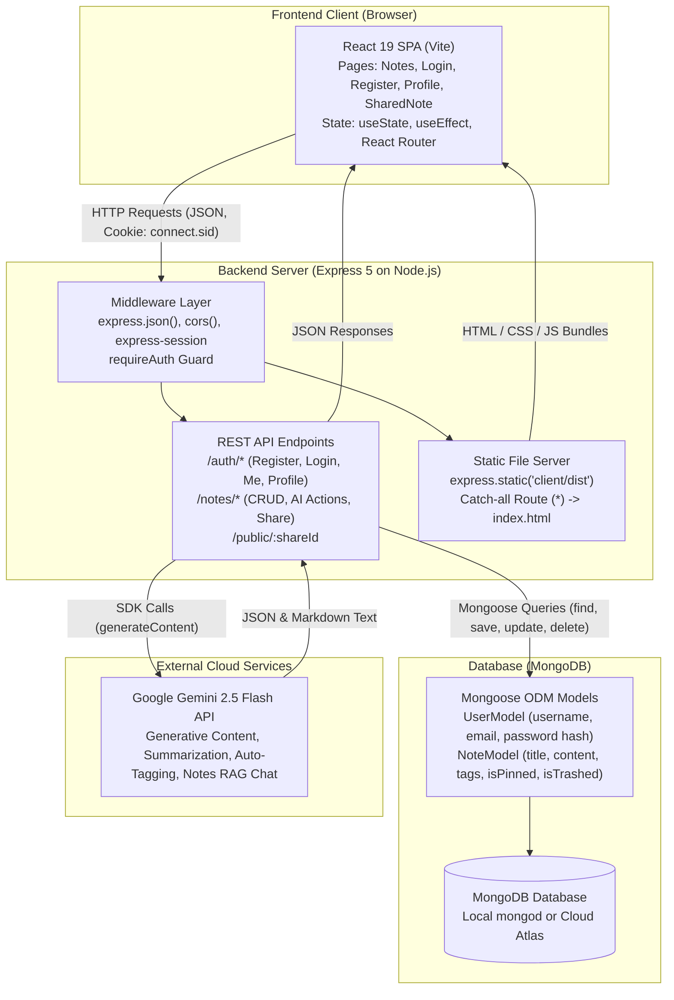
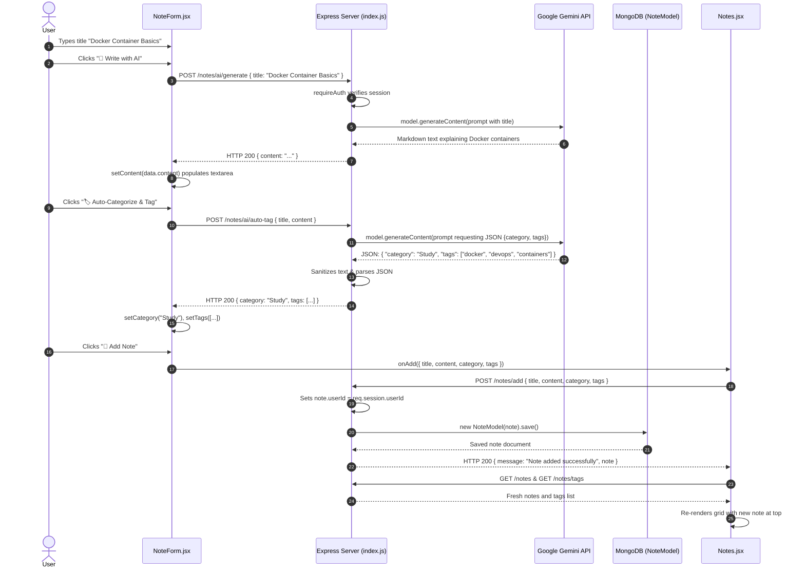
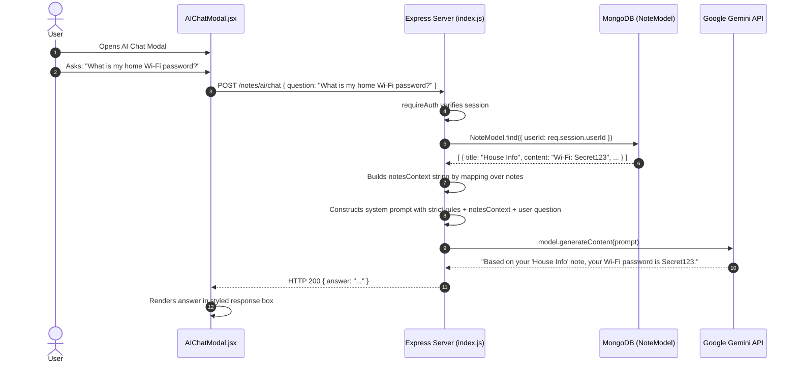

# Project Course: Personal Notes App (Antigravity)

> A comprehensive, file-by-file master reference and technical guide designed to take you from reading the code to confidently explaining, defending, and acing any technical interview or college viva.

---

## 1. Project Overview

### What the Project Does
The **Personal Notes App** is a full-stack personal knowledge management (PKM) platform that allows users to securely capture, organize, edit, and share notes formatted with Markdown. Beyond standard note-taking operations, it integrates Google's Gemini 2.5 Flash artificial intelligence to provide AI content generation from titles, automated categorization and keyword tagging, multi-style tone rewriting, and a conversational assistant that answers questions grounded strictly in the context of the user's saved notes.

### Full Tech Stack & Roles

| Layer / Technology | Role in This Application |
|---|---|
| **Node.js (v18+)** | Asynchronous JavaScript runtime environment that executes the backend server code outside the browser. |
| **Express 5.2.1** | Minimalist backend web framework handling HTTP routing, REST API endpoints, middleware execution, and static asset delivery. |
| **MongoDB & Mongoose 9.1.5** | **MongoDB** is the document-based NoSQL database engine storing users and notes as JSON-like documents. **Mongoose** is the Object-Data Modeling (ODM) library that enforces schemas, validations, and model relationships in Node.js. |
| **bcryptjs 3.0.3** | Cryptographic library used to hash user passwords with salt rounds before storing them in MongoDB, and verifying passwords during login without ever saving plaintext passwords. |
| **express-session 1.19.0** | Server-side session middleware that issues signed HTTP cookies (`connect.sid`) to clients and maintains session state in memory. |
| **@google/generative-ai 0.24.1** | Official Google GenAI SDK used to interface with the Gemini 2.5 Flash Large Language Model (LLM) for rewriting, tagging, content generation, and Q&A chat. |
| **uuid 13.0.0** | Generates cryptographically unique Version 4 UUID strings used as secure public tokens for shared note links. |
| **dotenv 17.3.1** | Loads environment variables from a local `.env` file into `process.env` at server initialization. |
| **cors 2.8.6** | Cross-Origin Resource Sharing middleware allowing the Vite development server (`http://localhost:5173`) to make authenticated credential-backed requests to the Express server (`http://localhost:3500`). |
| **React 19.2.4** | Declarative frontend user interface library using reactive state management and component lifecycle hooks to render a single-page application (SPA). |
| **Vite 8.0.0** | Next-generation frontend build tool and local development server providing instant Hot Module Replacement (HMR) and optimized production asset bundling. |
| **React Router DOM 7.13.1** | Client-side routing library managing page navigation (`/login`, `/register`, `/`, `/profile`, `/shared/:shareId`) without browser page reloads. |
| **react-markdown 10.1.0 & remark-gfm 4.0.1** | Component that parses and safely renders raw Markdown strings into HTML elements supporting GitHub Flavored Markdown (tables, task lists, strikethrough). |

---

### Architecture Diagram

The application uses a **Monolithic Decoupled Full-Stack Architecture**. In local development, Vite and Express run on separate ports with a development proxy. In production on Render, Express serves the pre-compiled Vite frontend bundle (`client/dist`) while simultaneously exposing the JSON REST API routes.



---

## 2. Folder & File Map

```
Personal-Notes-App/
├── index.js                      # Main server entry point: initializes Express, middleware, DB connection, API routes, and static file serving.
├── package.json                  # Root package file defining server dependencies, scripts, and build orchestrations.
├── .env.example                  # Template showing required and optional environment variable placeholders.
├── .gitignore                    # Specifies files and folders excluded from Git version tracking (node_modules, .env, etc.).
├── README.md                     # Project documentation including features, setup instructions, API contracts, and architecture notes.
│
├── config/
│   └── gemini.js                 # Configures and exports the GoogleGenerativeAI SDK client instance using GEMINI_API_KEY.
│
├── models/
│   ├── noteModel.js              # Mongoose schema and model definition for notes (title, content, category, tags, pin/trash flags, user reference).
│   └── userModel.js              # Mongoose schema and model definition for registered users (username, unique email, bcrypt password hash).
│
├── public/                       # Legacy static HTML/CSS prototype (unserved by the live Express application).
│   ├── index.html                # Legacy standalone dashboard prototype.
│   ├── login.html                # Legacy standalone login form prototype.
│   ├── register.html             # Legacy standalone registration form prototype.
│   └── style.css                 # Legacy CSS stylesheet for static prototype pages.
│
└── client/                       # Complete React 19 single-page application built with Vite.
    ├── package.json              # Frontend package manifest defining React, Vite, React Router, react-markdown, and ESLint.
    ├── index.html                # HTML entry point containing the `<div id="root"></div>` mount element for React.
    ├── vite.config.js            # Vite configuration defining plugins and development reverse proxy rules for backend API paths.
    ├── eslint.config.js          # ESLint 9 configuration with rules for React hooks and modern JavaScript.
    │
    ├── public/                   # Public static assets copied verbatim during frontend build.
    │   ├── favicon.svg           # Note-pad SVG favicon for the browser tab.
    │   └── icons.svg             # SVG icon definitions for the application UI.
    │
    └── src/                      # React source code.
        ├── main.jsx              # Application bootstrap script: initializes ReactDOM root and wraps App in BrowserRouter.
        ├── App.jsx               # Root React component: manages session validation state, dark/light theme, global toasts, and routes.
        ├── App.css               # Component-specific styles for the App shell.
        ├── index.css             # Comprehensive global stylesheet: CSS custom properties (variables), theme colors, layout, and UI utility classes.
        │
        ├── assets/               # Static bundled images and logos.
        │   ├── hero.png          # Visual banner image for dashboard presentation.
        │   ├── react.svg         # Default React framework logo.
        │   └── vite.svg          # Default Vite build tool logo.
        │
        ├── components/           # Modular, reusable React UI components.
        │   ├── NoteForm.jsx      # Form component for creating notes with AI generation, tone rewriting, and auto-tagging buttons.
        │   ├── NoteCard.jsx      # Card component rendering individual notes with markdown display, tag chips, and action triggers.
        │   ├── EditModal.jsx     # Pop-up dialog for editing an existing note with integrated AI rewriting and auto-tagging tools.
        │   ├── AIChatModal.jsx   # Interactive modal allowing the user to query an AI assistant across all their stored notes.
        │   ├── ShareModal.jsx    # Pop-up dialog displaying the unique public sharing link with one-click clipboard copying.
        │   └── Toast.jsx         # Non-intrusive notification banner displaying operation feedback that auto-dismisses after 3.2 seconds.
        │
        └── pages/                # Route-level page components.
            ├── Login.jsx         # Authentication page: email/password sign-in form with session cookie acquisition.
            ├── Register.jsx      # Registration page: new user signup form with password confirmation and client-side length checks.
            ├── Notes.jsx         # Primary dashboard page: search bar, category filters, tag filters, trash view, and responsive note card grid.
            ├── Profile.jsx       # Account management page: displays account stats, updates username/email, and handles password changes.
            └── SharedNote.jsx    # Publicly accessible page: fetches and renders a shared note by its unique UUID token without requiring authentication.
```

---

## 3. File-by-File Deep Dive

---

### `index.js`

#### What it does
`index.js` is the core backend entry point of the entire application. It initializes the Express application, configures security and session middleware, connects to the MongoDB database via Mongoose, defines all 19 REST API endpoints (authentication, note management, and Gemini AI operations), serves the compiled React production frontend from `client/dist`, and binds the server to an active network port.

#### Full Walkthrough

##### 1. Dependencies and Environment Configuration
```javascript
require('dotenv').config();
const express = require('express');
const path = require('path');
const mongoose = require('mongoose');
const bcrypt = require('bcryptjs');
const session = require('express-session');
const cors = require('cors');
const { v4: uuidv4 } = require('uuid');
const crypto = require('crypto');
const NoteModel = require('./models/noteModel');
const UserModel = require('./models/userModel');
const genAI = require('./config/gemini');
const app = express();
```
The file begins by calling `require('dotenv').config()`, which reads key-value pairs from the root `.env` file and attaches them to Node's global `process.env` object. It imports standard libraries (`path`, `crypto`), third-party frameworks (`express`, `mongoose`, `bcryptjs`, `express-session`, `cors`, `uuid`), and local modules (`NoteModel`, `UserModel`, and the configured Gemini AI SDK instance `genAI`).

##### 2. Dynamic Session Secret Validation & Middleware Setup
```javascript
// Session secret configuration
let sessionSecret = process.env.SESSION_SECRET;

if (process.env.NODE_ENV === 'production') {
    if (!sessionSecret || sessionSecret.length < 32) {
        console.error('FATAL: SESSION_SECRET environment variable is missing or shorter than 32 characters in production.');
        process.exit(1);
    }
} else {
    if (!sessionSecret) {
        console.warn('WARNING: SESSION_SECRET is not set. Generating a random per-process secret for development.');
        sessionSecret = crypto.randomBytes(32).toString('hex');
    }
}

// Middleware
app.use(express.json());
app.use(cors({
    origin: 'http://localhost:5173',
    credentials: true
}));
app.use(session({
    secret: sessionSecret,
    resave: false,
    saveUninitialized: false,
    cookie: { maxAge: 24 * 60 * 60 * 1000 }
}));
```
This section safeguards the session signing key. If the application detects `NODE_ENV === 'production'` and the `SESSION_SECRET` environment variable is either missing or shorter than 32 characters, it immediately halts execution with `process.exit(1)`. In development mode, if the variable is omitted, it issues a console warning and generates an ephemeral 32-byte hexadecimal secret via `crypto.randomBytes(32).toString('hex')`.

Next, three core middlewares are mounted:
1. `express.json()`: Parses incoming HTTP request bodies formatted as JSON, exposing the parsed data on `req.body`.
2. `cors(...)`: Allows the local Vite development frontend (`http://localhost:5173`) to make asynchronous HTTP requests while permitting cookies (`credentials: true`).
3. `session(...)`: Configures session handling. `resave: false` prevents sessions from being re-saved to the store if untouched during a request. `saveUninitialized: false` prevents unauthenticated visits from receiving empty session cookies. `maxAge: 24 * 60 * 60 * 1000` sets the cookie lifetime to 24 hours.

##### 3. Database Connection and Server Listening
```javascript
const PORT = process.env.PORT || 3500;
app.listen(PORT, async () => {
    try {
        const MONGODB_URI = process.env.MONGODB_URI || "mongodb://127.0.0.1:27017/notesdb";
        await mongoose.connect(MONGODB_URI);
        console.log(`Connected to MongoDB: ${MONGODB_URI.includes('127.0.0.1') ? 'Local Database' : 'Cloud Atlas'}`);
    } catch (err) {
        console.log("Error connecting to MongoDB:", err);
    }
    console.log(`Server is running on port ${PORT}`);
});
```
The server binds to `process.env.PORT` (assigned automatically by hosting platforms like Render) or defaults to `3500`. Once listening, it connects asynchronously to MongoDB using Mongoose. If `MONGODB_URI` contains `127.0.0.1`, it logs that a local database is connected; otherwise, it reports Cloud Atlas.

##### 4. Authentication Routes
```javascript
// POST /auth/register
app.post("/auth/register", async (req, res) => {
    try {
        let { username, email, password } = req.body;

        let existingUser = await UserModel.findOne({ email });
        if (existingUser) {
            return res.status(400).json({ message: "Email already registered" });
        }

        let existingUsername = await UserModel.findOne({ username });
        if (existingUsername) {
            return res.status(400).json({ message: "Username already taken" });
        }

        let salt = await bcrypt.genSalt(10);
        let hashedPassword = await bcrypt.hash(password, salt);

        let newUser = new UserModel({ username, email, password: hashedPassword });
        await newUser.save();
        res.status(201).json({ message: "Registration successful! Please login." });
    } catch (err) {
        res.status(500).json({ message: err.message });
    }
});

// POST /auth/login
app.post("/auth/login", async (req, res) => {
    try {
        let { email, password } = req.body;

        let user = await UserModel.findOne({ email });
        if (!user) {
            return res.status(400).json({ message: "Invalid email or password" });
        }

        let isMatch = await bcrypt.compare(password, user.password);
        if (!isMatch) {
            return res.status(400).json({ message: "Invalid email or password" });
        }

        req.session.userId = user._id;
        req.session.username = user.username;
        res.json({ message: "Login successful!", username: user.username });
    } catch (err) {
        res.status(500).json({ message: err.message });
    }
});

// GET /auth/me
app.get("/auth/me", async (req, res) => {
    try {
        if (req.session.userId) {
            res.json({ userId: req.session.userId, username: req.session.username });
        } else {
            res.status(401).json({ message: "Not logged in" });
        }
    } catch (err) {
        res.status(500).json({ message: err.message });
    }
});

// POST /auth/logout
app.post("/auth/logout", async (req, res) => {
    try {
        req.session.destroy();
        res.json({ message: "Logged out successfully" });
    } catch (err) {
        res.status(500).json({ message: err.message });
    }
});
```
- **Registration (`/auth/register`):** Validates uniqueness of both email and username. Uses `bcrypt.genSalt(10)` and `bcrypt.hash(...)` to create a one-way mathematical hash of the password before saving to the database.
- **Login (`/auth/login`):** Finds the user document by email. Uses `bcrypt.compare(...)` to check whether the submitted plaintext password generates the same hash. If valid, attaches `userId` and `username` to `req.session`. Express Session automatically signs a cookie and sends it to the browser in the `Set-Cookie` header.
- **Session Check (`/auth/me`):** Checks whether `req.session.userId` exists. If so, returns the authenticated user data; otherwise, returns HTTP 401.
- **Logout (`/auth/logout`):** Destroys the session in server memory with `req.session.destroy()`.

##### 5. User Profile Management Routes
```javascript
// GET /auth/profile — get full user profile
app.get("/auth/profile", requireAuth, async (req, res) => {
    try {
        let user = await UserModel.findById(req.session.userId).select('-password');
        let notesCount = await NoteModel.countDocuments({ userId: req.session.userId });
        res.json({
            username: user.username,
            email: user.email,
            createdAt: user.createdAt,
            notesCount: notesCount
        });
    } catch (err) {
        res.status(500).json({ message: err.message });
    }
});

// PUT /auth/profile/update — update username/email
app.put("/auth/profile/update", requireAuth, async (req, res) => {
    try {
        let { username, email } = req.body;
        let userId = req.session.userId;

        let existingUsername = await UserModel.findOne({ username, _id: { $ne: userId } });
        if (existingUsername) {
            return res.status(400).json({ message: "Username already taken" });
        }

        let existingEmail = await UserModel.findOne({ email, _id: { $ne: userId } });
        if (existingEmail) {
            return res.status(400).json({ message: "Email already registered" });
        }

        let updatedUser = await UserModel.findByIdAndUpdate(
            userId,
            { username, email },
            { new: true }
        ).select('-password');

        req.session.username = updatedUser.username;
        res.json({ message: "Profile updated successfully", user: updatedUser });
    } catch (err) {
        res.status(500).json({ message: err.message });
    }
});

// PUT /auth/password/change — change password
app.put("/auth/password/change", requireAuth, async (req, res) => {
    try {
        let { currentPassword, newPassword } = req.body;
        let user = await UserModel.findById(req.session.userId);

        let isMatch = await bcrypt.compare(currentPassword, user.password);
        if (!isMatch) {
            return res.status(400).json({ message: "Current password is incorrect" });
        }

        let salt = await bcrypt.genSalt(10);
        let hashedPassword = await bcrypt.hash(newPassword, salt);

        await UserModel.findByIdAndUpdate(req.session.userId, { password: hashedPassword });
        res.json({ message: "Password changed successfully" });
    } catch (err) {
        res.status(500).json({ message: err.message });
    }
});
```
These routes allow users to view their account metadata, update their username/email (checking collisions via MongoDB `$ne` query operator), and securely change their password after validating their current password.

##### 6. Protected Route Guard Middleware
```javascript
function requireAuth(req, res, next) {
    if (req.session.userId) {
        next();
    } else {
        res.status(401).json({ message: "Please login first" });
    }
}
```
`requireAuth` is an Express route guard. It inspects `req.session.userId`. If an active session exists, it executes `next()` to hand off control to the route handler. If not, it halts the request with HTTP 401 Unauthorized.

##### 7. Note CRUD & Sharing Routes
```javascript
// POST /notes/add
app.post("/notes/add", requireAuth, async (req, res) => {
    try {
        let note = req.body;
        note.userId = req.session.userId;
        if (note.tags && typeof note.tags === 'string') {
            note.tags = note.tags.split(',').map(t => t.trim().toLowerCase()).filter(Boolean);
        }
        let newNote = new NoteModel(note);
        await newNote.save();
        res.json({ message: "Note added successfully", note: newNote });
    } catch (err) {
        res.status(500).json({ message: err.message });
    }
});

// GET /notes
app.get("/notes", requireAuth, async (req, res) => {
    try {
        let notes = await NoteModel.find({ userId: req.session.userId });
        res.json(notes);
    } catch (err) {
        res.status(500).json({ message: err.message });
    }
});

// GET /notes/tags — get unique tags for the user
app.get("/notes/tags", requireAuth, async (req, res) => {
    try {
        let tags = await NoteModel.distinct("tags", { userId: req.session.userId });
        res.json(tags);
    } catch (err) {
        res.status(500).json({ message: err.message });
    }
});

// GET /notes/:id
app.get("/notes/:id", requireAuth, async (req, res) => {
    try {
        let id = req.params.id;
        let note = await NoteModel.findById(id);
        res.json(note);
    } catch (err) {
        res.status(500).json({ message: err.message });
    }
});

// PUT /notes/update/:id
app.put("/notes/update/:id", requireAuth, async (req, res) => {
    try {
        let id = req.params.id;
        let updateData = req.body;
        if (updateData.tags && typeof updateData.tags === 'string') {
            updateData.tags = updateData.tags.split(',').map(t => t.trim().toLowerCase()).filter(Boolean);
        }
        let updatedNote = await NoteModel.findByIdAndUpdate(id, updateData, { new: true });
        res.json(updatedNote);
    } catch (err) {
        res.status(500).json({ message: err.message });
    }
});

// DELETE /notes/delete/:id
app.delete("/notes/delete/:id", requireAuth, async (req, res) => {
    try {
        let id = req.params.id;
        await NoteModel.findByIdAndDelete(id);
        res.json({ message: "Note deleted successfully" });
    } catch (err) {
        res.status(500).json({ message: err.message });
    }
});

// POST /notes/share/:id — toggle sharing
app.post("/notes/share/:id", requireAuth, async (req, res) => {
    try {
        let id = req.params.id;
        let note = await NoteModel.findById(id);

        if (!note || note.userId.toString() !== req.session.userId) {
            return res.status(404).json({ message: "Note not found" });
        }

        if (note.isPublic) {
            note.isPublic = false;
            note.shareId = "";
        } else {
            note.isPublic = true;
            note.shareId = uuidv4();
        }

        await note.save();
        res.json({ message: note.isPublic ? "Note shared!" : "Note unshared", note });
    } catch (err) {
        res.status(500).json({ message: err.message });
    }
});

// GET /public/:shareId — view a shared note (NO auth required)
app.get("/public/:shareId", async (req, res) => {
    try {
        let shareId = req.params.shareId;
        let note = await NoteModel.findOne({ shareId, isPublic: true });

        if (!note) {
            return res.status(404).json({ message: "Shared note not found or no longer public" });
        }

        let author = await UserModel.findById(note.userId).select('username');
        res.json({
            title: note.title,
            content: note.content,
            category: note.category,
            tags: note.tags,
            createdAt: note.createdAt,
            author: author ? author.username : 'Unknown'
        });
    } catch (err) {
        res.status(500).json({ message: err.message });
    }
});
```
- Tag sanitation formats incoming string tags into trimmed, lowercase arrays.
- `GET /notes` retrieves all notes belonging to the logged-in user.
- `GET /notes/tags` uses Mongoose's `.distinct("tags", { userId })` to compile an array of unique tag strings used across that user's library.
- `POST /notes/share/:id` toggles the public state: if unshared, it generates a fresh UUID (`uuidv4()`); if shared, it clears the token and resets `isPublic = false`.
- `GET /public/:shareId` allows anyone with the UUID to fetch the note contents and author username without requiring any session cookie.

##### 8. Google Gemini AI Routes
```javascript
// POST /notes/ai/rewrite
app.post("/notes/ai/rewrite", requireAuth, async (req, res) => {
    try {
        const { title, content, style } = req.body;
        if (!content) return res.status(400).json({ message: "Content is required for AI rewrite." });
        
        let promptModifier = "Fix grammar and improve readability.";
        if (style === 'professional') promptModifier = "Make the tone highly professional, concise, and structured.";
        if (style === 'casual') promptModifier = "Make the tone friendly, casual, and easy to read.";
        if (style === 'expand') promptModifier = "Expand on the ideas, making it longer and more detailed.";
        if (style === 'summarize') promptModifier = "Summarize the key points in a bulleted list.";

        const prompt = `You are an expert writing assistant. Your task is to rewrite the following note.
        ${promptModifier}
        
        Original Title: ${title || 'Untitled'}
        Original Content: ${content}

        Return the response EXACTLY in this JSON format (no markdown, no backticks, just raw JSON that can be parsed by JSON.parse):
        {
          "title": "Improved Title (if applicable, else original)",
          "content": "The newly polished and rewritten content here..."
        }`;

        const model = genAI.getGenerativeModel({ model: "gemini-2.5-flash" });
        const result = await model.generateContent(prompt);
        let text = result.response.text();
        
        text = text.replace(/```json/gi, '').replace(/```/g, '').trim();

        const improvedNote = JSON.parse(text);
        res.json(improvedNote);
    } catch (err) {
        console.error("AI Rewrite Error:", err);
        res.status(500).json({ message: "Failed to rewrite note. Please try again." });
    }
});
```
The AI endpoints prompt Gemini with explicit instructions and clean the returned text of any markdown code blocks before parsing via `JSON.parse()`. Similar routes handle auto-tagging (`/notes/ai/auto-tag`), generating content from titles (`/notes/ai/generate`), and conversational chat (`/notes/ai/chat`) which pulls all of the user's notes from MongoDB and injects them as an in-prompt context window.

##### 9. Static File Serving & React SPA Routing
```javascript
// Serve the React frontend locally or in production
app.use(express.static(path.join(__dirname, 'client/dist')));

// Catch-all route to hand over routing to React Router
app.use((req, res, next) => {
    if (req.method === 'GET' && !req.path.startsWith('/notes') && !req.path.startsWith('/auth')) {
        res.sendFile(path.join(__dirname, 'client/dist', 'index.html'));
    } else {
        next();
    }
});
```
In production, Express serves pre-built static client files (`client/dist`). If an incoming `GET` request does not match an API route (i.e. does not begin with `/notes` or `/auth`), Express sends `client/dist/index.html`. This allows client-side routing libraries like React Router to handle nested browser URLs like `/login` or `/shared/abc-123` on refresh without triggering 404 errors.

#### Concepts a Beginner Might Not Know

- **Middleware:** A function in Express that sits between an incoming HTTP request and the final route response, able to inspect headers, modify `req`/`res`, or reject requests early.
- **Bcrypt Salt:** A random string concatenated with a password before hashing to ensure that identical passwords produce completely different stored hashes, defending against pre-computed rainbow table attacks.
- **Session Cookie:** A tiny text token stored in the browser that identifies an active user session on the server across multiple subsequent HTTP requests without re-sending the password.
- **Single-Page Application (SPA) Fallback Routing:** The practice of returning the root `index.html` file for any unmatched browser route so that client-side JavaScript can take over rendering the correct view.

#### Why This Approach, Not an Alternative

- **`express-session` with in-memory store:** In-memory storage is zero-configuration and requires no extra database setup during early development. However, it is an architectural weakness for production: active sessions are lost whenever Render restarts the service, and memory leaks will accumulate in long-running processes. A production-grade alternative would be `connect-mongo`, which stores sessions directly in MongoDB.
- **Direct Prompt Ingestion for Notes Chat:** The `/notes/ai/chat` endpoint pulls all notes into a single concatenated prompt string. While simple and effective for small portfolios, this naive Retrieval-Augmented Generation (RAG) approach will hit LLM token limits or incur high latency as a user's library grows into hundreds of notes. A scalable alternative would use vector embeddings and a similarity search index.
- **Incomplete Note Ownership Checking on ID routes:** In `GET /notes/:id`, `PUT /notes/update/:id`, and `DELETE /notes/delete/:id`, the queries do not filter by `userId: req.session.userId`. This creates an Insecure Direct Object Reference (IDOR) vulnerability where any authenticated user who guesses a valid MongoDB `ObjectId` can view, alter, or delete someone else's note. A production implementation should query `{ _id: id, userId: req.session.userId }`.

#### Connects to
- **Imports:** `models/noteModel.js`, `models/userModel.js`, `config/gemini.js`.
- **Serves:** Static files compiled into `client/dist/`.
- **Communicates with:** MongoDB via Mongoose connection; Google Generative AI API via `genAI`.

---

### `config/gemini.js`

#### What it does
Initializes and exports the official Google Generative AI client singleton configured with the API key stored in the `GEMINI_API_KEY` environment variable.

#### Full Walkthrough
```javascript
const { GoogleGenerativeAI } = require("@google/generative-ai");

// Access your API key as an environment variable
// Make sure you have created a .env file with GEMINI_API_KEY=your_key
const genAI = new GoogleGenerativeAI(process.env.GEMINI_API_KEY);

module.exports = genAI;
```
The file imports the `GoogleGenerativeAI` constructor class from `@google/generative-ai`, instantiates it using `process.env.GEMINI_API_KEY`, and exports that single instance for use by backend route handlers.

#### Concepts a Beginner Might Not Know
- **Singleton Pattern:** A design pattern where only one shared instance of an object or client is instantiated and reused throughout the entire application lifecycle rather than creating a new client on every request.
- **Environment Variable (`process.env`):** A dynamic configuration value injected into the operating system process at runtime, keeping secret keys out of committed source code.

#### Why This Approach, Not an Alternative
- **Dedicated Config Module:** Extracting the AI client initialization into `config/gemini.js` isolates external SDK configuration from the server routes. An alternative would be initializing the SDK inside each route in `index.js`, which would duplicate connection overhead and clutter routing logic.
- **Weakness:** The file does not validate whether `process.env.GEMINI_API_KEY` is defined at initialization. If missing, errors are delayed until a user triggers an AI route at runtime. A stronger pattern would check for the key at startup and emit a fatal configuration error.

#### Connects to
- **Imported by:** `index.js`.
- **Requires:** `GEMINI_API_KEY` in environment.

---

### `models/userModel.js`

#### What it does
Defines the Mongoose schema and database model for registered user accounts, specifying the required fields, uniqueness rules, and default values.

#### Full Walkthrough
```javascript
const mongoose = require('mongoose');

const userSchema = mongoose.Schema({
    username: { type: String, required: true, unique: true },
    email: { type: String, required: true, unique: true },
    password: { type: String, required: true },
    createdAt: { type: Date, default: Date.now }
});
const UserModel = mongoose.model("user", userSchema);

module.exports = UserModel;
```
- `username`: Required, unique string.
- `email`: Required, unique string used for authentication.
- `password`: Required string storing the bcrypt-hashed password.
- `createdAt`: Date defaulting to the current timestamp `Date.now`.
- `mongoose.model("user", userSchema)` creates and exports the Mongoose model linked to the `users` collection in MongoDB.

#### Concepts a Beginner Might Not Know
- **Mongoose Schema:** A blueprint that defines the structure, data types, and validation rules of documents inside a MongoDB collection.
- **Unique Index (`unique: true`):** A database constraint that tells MongoDB to reject any attempt to insert a duplicate value for that field across the entire collection.

#### Why This Approach, Not an Alternative
- **Mongoose vs. Native MongoDB Driver:** Mongoose provides automatic type validation, schema enforcement, and readable query builders. Using the native MongoDB driver would require manual validation of document properties before every insert and update.
- **Password Storage:** Notice that `password` stores the hash directly. Some projects use Mongoose `pre('save')` hooks to hash passwords automatically. By performing the hashing explicitly in the route handler in `index.js`, the code avoids unexpected re-hashing bugs during profile updates.

#### Connects to
- **Imported by:** `index.js` for user registration, authentication verification, profile updates, and author lookup on shared notes.

---

### `models/noteModel.js`

#### What it does
Defines the Mongoose schema and database model for personal notes, encompassing title, content, categorization, custom tags, public sharing flags, pin status, soft-delete trash status, and ownership references to the `UserModel`.

#### Full Walkthrough
```javascript
const mongoose = require('mongoose');

const noteSchema = mongoose.Schema({
    title: { type: String, required: true },
    content: { type: String, required: true },
    category: { type: String, default: "Personal" },
    tags: { type: [String], default: [] },
    isPublic: { type: Boolean, default: false },
    shareId: { type: String, default: "" },
    isPinned: { type: Boolean, default: false },
    isTrashed: { type: Boolean, default: false },
    userId: { type: mongoose.Schema.Types.ObjectId, ref: "user", required: true },
    createdAt: { type: Date, default: Date.now }
});
const NoteModel = mongoose.model("note", noteSchema);

module.exports = NoteModel;
```
- `title` & `content`: Required string fields holding the note heading and raw markdown text.
- `category`: String defaulting to `"Personal"`.
- `tags`: Array of strings (`[String]`) representing individual tag keywords.
- `isPublic` & `shareId`: Boolean flag and UUID string for unauthenticated sharing.
- `isPinned`: Boolean flag used by the UI to sort priority notes to the top of the grid.
- `isTrashed`: Boolean flag enabling soft-delete and restore capabilities.
- `userId`: A relational reference (`mongoose.Schema.Types.ObjectId`) referencing the `user` model, establishing note ownership.
- `createdAt`: Date timestamp defaulting to `Date.now`.

#### Concepts a Beginner Might Not Know
- **Foreign Key / ObjectId Reference (`ref: "user"`):** A pattern in Mongoose where a field stores the `_id` of a document from another collection, establishing a relationship between data (e.g. associating notes with their creator).
- **Soft Delete:** A data design pattern where a record is marked as deleted using a boolean flag (`isTrashed: true`) instead of physically removing it from the database table, allowing users to restore mistakenly deleted items.

#### Why This Approach, Not an Alternative
- **Tags as an Array of Strings:** Storing tags directly on each note document (`tags: [String]`) leverages MongoDB's native multi-key indexing and avoids the need for a separate relational join table (like a `tags` and `note_tags` table in SQL).
- **UUID for Public Sharing:** Rather than exposing the internal MongoDB `_id` in public URLs, the schema uses a dedicated `shareId` UUID. This prevents attackers from enumerating notes or discovering database primary keys.

#### Connects to
- **Imported by:** `index.js` for all note CRUD operations, user statistics counting, and public note retrieval.
- **Relates to:** `models/userModel.js` via the `userId` ObjectId reference.

---

### `client/vite.config.js`

#### What it does
Configures the Vite build tool and development server. It registers the official React plugin for JSX compilation and configures development proxy rules so the frontend can seamlessly communicate with the backend during local development without triggering CORS issues.

#### Full Walkthrough
```javascript
import { defineConfig } from 'vite'
import react from '@vitejs/plugin-react'

export default defineConfig({
  plugins: [react()],
  server: {
    port: 5173,
    proxy: {
      '/auth': {
        target: 'http://localhost:3500',
        changeOrigin: true,
      },
      '/notes': {
        target: 'http://localhost:3500',
        changeOrigin: true,
      },
      '/public': {
        target: 'http://localhost:3500',
        changeOrigin: true,
      },
    },
  },
})
```
- `plugins: [react()]`: Injects Babel/SWC plugins to enable Fast Refresh and JSX transformation.
- `server.port: 5173`: Binds Vite's local dev server to port 5173.
- `server.proxy`: Configures an internal reverse proxy in development. Any frontend request directed to `/auth/*`, `/notes/*`, or `/public/*` is intercepted by Vite and forwarded to `http://localhost:3500`, with `changeOrigin: true` rewriting the HTTP `Host` header to match the target.

#### Concepts a Beginner Might Not Know
- **Development Reverse Proxy:** A development tool where the local frontend server forwards API calls to the backend on the programmer's behalf, making API calls appear same-origin to the browser and avoiding CORS restrictions.
- **Hot Module Replacement (HMR):** A development feature provided by tools like Vite where updated code modules are injected into the running browser application without triggering a full page reload, preserving state.

#### Why This Approach, Not an Alternative
- **Proxying vs. Hardcoded API URLs:** Without a proxy, frontend code would have to write `fetch('http://localhost:3500/notes')`. That hardcoded URL would fail when deployed to production under a different domain name. By using relative paths (`/notes`) and a dev proxy, the exact same frontend code works both locally and on Render.

#### Connects to
- **Used by:** Vite CLI during `npm run dev` and `npm run build`.
- **Routes to:** Express backend running on `http://localhost:3500`.

---

### `client/src/main.jsx`

#### What it does
The primary entry point of the React client application. It mounts the root component tree onto the DOM element `<div id="root"></div>` inside `index.html` and wraps the entire application with React Router's `BrowserRouter`.

#### Full Walkthrough
```javascript
import { StrictMode } from 'react'
import { createRoot } from 'react-dom/client'
import { BrowserRouter } from 'react-router-dom'
import App from './App.jsx'
import './index.css'

createRoot(document.getElementById('root')).render(
  <StrictMode>
    <BrowserRouter>
      <App />
    </BrowserRouter>
  </StrictMode>,
)
```
- `createRoot(...)`: Uses React 18/19's concurrent rendering root API.
- `<StrictMode>`: A developer tool that runs checks, highlights potential side effects, and double-invokes render lifecycles in development to expose bugs.
- `<BrowserRouter>`: Provides the HTML5 History API context necessary for client-side routing.
- Imports `index.css`, making global styles available across all pages.

#### Concepts a Beginner Might Not Know
- **Concurrent Root (`createRoot`):** React's modern entry point API that enables background rendering and prioritized UI updates.
- **HTML5 History API:** A browser feature (`window.history.pushState`) that allows JavaScript applications to change the URL displayed in the address bar without causing the browser to reload the page.

#### Why This Approach, Not an Alternative
- **`BrowserRouter` vs. `HashRouter`:** `BrowserRouter` produces clean, modern URLs like `/notes` and `/profile`. An older alternative, `HashRouter`, uses `#` fragments (e.g. `/#/notes`). `BrowserRouter` is the standard for modern web development, provided the backend is configured with SPA fallback routing.

#### Connects to
- **Renders:** `client/src/App.jsx`.
- **Mounts into:** `client/index.html` at `<div id="root"></div>`.
- **Loads:** `client/src/index.css`.

---

### `client/src/App.jsx`

#### What it does
The top-level shell of the React application. It maintains global application state including the authenticated user session, initial loading state, active dark/light theme, and transient toast notification messages. It also configures the central routing switchboard using React Router.

#### Full Walkthrough

##### 1. State Management and Theme Synchronization
```javascript
function App() {
  const [user, setUser] = useState(null)
  const [loading, setLoading] = useState(true)
  const [toast, setToast] = useState(null)
  const [theme, setTheme] = useState(localStorage.getItem('theme') || 'dark')

  useEffect(() => {
    document.documentElement.setAttribute('data-theme', theme)
    localStorage.setItem('theme', theme)
  }, [theme])

  const toggleTheme = () => {
    setTheme(prev => prev === 'dark' ? 'light' : 'dark')
  }

  const showToast = (message, type = 'success') => {
    setToast({ message, type })
    setTimeout(() => setToast(null), 3000)
  }
```
- Manages `theme` using `localStorage` persistence and applies `data-theme` to the HTML root element (`<html>`).
- `showToast` sets a message object that automatically clears after 3000ms.

##### 2. Session Validation on Mount
```javascript
  const checkAuth = async () => {
    try {
      const res = await fetch('/auth/me', { credentials: 'include' })
      if (res.ok) {
        const data = await res.json()
        setUser(data)
      } else {
        setUser(null)
      }
    } catch {
      setUser(null)
    } finally {
      setLoading(false)
    }
  }

  useEffect(() => {
    checkAuth()
  }, [])
```
When the app first mounts, it immediately makes a GET request to `/auth/me` with `credentials: 'include'`. If the server returns HTTP 200, it stores the user object in state; otherwise, `user` remains `null`. `loading` transitions from `true` to `false`.

##### 3. Logout Handler & Loading Guard
```javascript
  const handleLogout = async () => {
    try {
      await fetch('/auth/logout', { method: 'POST', credentials: 'include' })
      setUser(null)
      showToast('Logged out successfully')
    } catch {
      setUser(null)
    }
  }

  if (loading) {
    return (
      <div className="loading-screen">
        <div className="loading-spinner"></div>
        <p>Loading...</p>
      </div>
    )
  }
```
Before session status is verified, the app displays a full-screen loading spinner to prevent UI flickering or improper redirects.

##### 4. Routing Switchboard & Protected Navigation
```javascript
  return (
    <>
      {toast && <Toast message={toast.message} type={toast.type} onClose={() => setToast(null)} />}
      <Routes>
        <Route
          path="/login"
          element={user ? <Navigate to="/" /> : <Login setUser={setUser} showToast={showToast} />}
        />
        <Route
          path="/register"
          element={user ? <Navigate to="/" /> : <Register showToast={showToast} />}
        />
        <Route
          path="/"
          element={
            user
              ? <Notes user={user} onLogout={handleLogout} showToast={showToast} theme={theme} toggleTheme={toggleTheme} />
              : <Navigate to="/login" />
          }
        />
        <Route
          path="/profile"
          element={
            user
              ? <Profile user={user} setUser={setUser} onLogout={handleLogout} showToast={showToast} theme={theme} toggleTheme={toggleTheme} />
              : <Navigate to="/login" />
          }
        />
        <Route
          path="/shared/:shareId"
          element={<SharedNote />}
        />
        <Route path="*" element={<Navigate to="/" />} />
      </Routes>
    </>
  )
```
- Unauthenticated users attempting to access `/` or `/profile` are redirected via `<Navigate to="/login" />`.
- Authenticated users attempting to visit `/login` or `/register` are redirected to `/`.
- Public shared notes (`/shared/:shareId`) are accessible by anyone without authentication.

#### Concepts a Beginner Might Not Know
- **`credentials: 'include'`:** A Fetch API option instructing the browser to include HTTP cookies with cross-origin or same-origin asynchronous network requests.
- **`<Navigate to="..." />`:** A React Router component that programmatically changes the browser location when rendered.
- **Global Toast Notification:** A transient alert box positioned above normal UI layers used to communicate success or error states to users.

#### Why This Approach, Not an Alternative
- **Initial Auth Verification via `/auth/me`:** Some apps store auth state in `localStorage`. However, tokens in `localStorage` are vulnerable to Cross-Site Scripting (XSS) attacks. Using server-validated session cookies with an initial `/auth/me` ping ensures that the client's auth state is always synchronized with the server's session store.
- **Props Drilling vs. Context API:** User and toast props are passed down directly to route components. For a small application with 4 pages, direct prop passing is simple, predictable, and avoids the boilerplate of a Redux or React Context provider.

#### Connects to
- **Imported by:** `client/src/main.jsx`.
- **Renders:** `Login.jsx`, `Register.jsx`, `Notes.jsx`, `Profile.jsx`, `SharedNote.jsx`, `Toast.jsx`.
- **Calls Backend Endpoints:** `GET /auth/me`, `POST /auth/logout`.

---

### `client/src/pages/Login.jsx`

#### What it does
Provides the user login interface, capturing the user's email and password, submitting them to the authentication backend, handling errors, and navigating to the dashboard upon successful sign-in.

#### Full Walkthrough
```javascript
function Login({ setUser, showToast }) {
  const [email, setEmail] = useState('')
  const [password, setPassword] = useState('')
  const [submitting, setSubmitting] = useState(false)
  const navigate = useNavigate()

  const handleSubmit = async (e) => {
    e.preventDefault()
    if (!email || !password) {
      showToast('Please fill in all fields', 'error')
      return
    }

    setSubmitting(true)
    try {
      const res = await fetch('/auth/login', {
        method: 'POST',
        headers: { 'Content-Type': 'application/json' },
        credentials: 'include',
        body: JSON.stringify({ email, password })
      })
      const data = await res.json()

      if (res.ok) {
        showToast('Welcome back! 🎉', 'success')
        setUser({ username: data.username })
        navigate('/')
      } else {
        showToast(data.message, 'error')
      }
    } catch {
      showToast('Login failed. Please try again.', 'error')
    } finally {
      setSubmitting(false)
    }
  }
```
1. Captures `email` and `password` via controlled `<input>` fields.
2. Intercepts form submission with `e.preventDefault()`.
3. Dispatches a `POST` request to `/auth/login`.
4. If successful (`res.ok`), updates the root `user` state via `setUser(...)` and programmatically navigates to `/` using `navigate('/')`.
5. Disables the submission button while `submitting` is true to prevent duplicate network requests.

#### Concepts a Beginner Might Not Know
- **Controlled Components:** Form input elements whose values are tied to React component state (`value={email}`) and updated via change handlers (`onChange={(e) => setEmail(e.target.value)}`).
- **`e.preventDefault()`:** Prevents the browser's default behavior (which for forms is to refresh the entire page and append query parameters to the URL).

#### Why This Approach, Not an Alternative
- **`useNavigate` Hook:** React Router's programmatic navigation hook allows smooth, client-side route transitions without losing client memory or causing browser screen flashes.

#### Connects to
- **Imported by:** `client/src/App.jsx`.
- **Calls Backend Endpoint:** `POST /auth/login`.

---

### `client/src/pages/Register.jsx`

#### What it does
Provides the account registration interface with client-side form validation (checking field presence, minimum password length, and password confirmation matching) before submitting the payload to `/auth/register`.

#### Full Walkthrough
```javascript
function Register({ showToast }) {
  const [username, setUsername] = useState('')
  const [email, setEmail] = useState('')
  const [password, setPassword] = useState('')
  const [confirmPassword, setConfirmPassword] = useState('')
  const [submitting, setSubmitting] = useState(false)
  const navigate = useNavigate()

  const handleSubmit = async (e) => {
    e.preventDefault()

    if (!username || !email || !password || !confirmPassword) {
      showToast('Please fill in all fields', 'error')
      return
    }
    if (password !== confirmPassword) {
      showToast('Passwords do not match', 'error')
      return
    }
    if (password.length < 6) {
      showToast('Password must be at least 6 characters', 'error')
      return
    }

    setSubmitting(true)
    try {
      const res = await fetch('/auth/register', {
        method: 'POST',
        headers: { 'Content-Type': 'application/json' },
        credentials: 'include',
        body: JSON.stringify({ username, email, password })
      })
      const data = await res.json()

      if (res.ok) {
        showToast('Account created! Please login. ✨', 'success')
        setTimeout(() => navigate('/login'), 1200)
      } else {
        showToast(data.message, 'error')
      }
    } catch {
      showToast('Registration failed. Please try again.', 'error')
    } finally {
      setSubmitting(false)
    }
  }
```
Client-side validation verifies:
1. All fields are populated.
2. `password === confirmPassword`.
3. `password.length >= 6`.
If checks pass, it sends the registration payload. On success, it displays a success toast and redirects to `/login` after a brief 1.2-second delay.

#### Concepts a Beginner Might Not Know
- **Client-Side Validation:** Validating user input in the browser before sending it across the network to provide instant feedback and avoid unnecessary server load.
- **`setTimeout` in Navigation:** A timed delay used here to allow the user to read the success toast notification before transitioning them to the login screen.

#### Why This Approach, Not an Alternative
- **Redirect to Login vs. Auto-Login:** Instead of automatically logging the user in upon registration, the app routes them to the login page. This guarantees that new users can independently authenticate with their chosen credentials and prevents session ambiguity.

#### Connects to
- **Imported by:** `client/src/App.jsx`.
- **Calls Backend Endpoint:** `POST /auth/register`.

---

### `client/src/pages/Notes.jsx`

#### What it does
The primary workspace and dashboard of the application. It fetches, sorts, filters, and displays the user's notes, hosts the note creation form, handles search queries, manages soft-delete trash and restore workflows, and controls modal dialogs for editing, sharing, and AI chat.

#### Full Walkthrough

##### 1. State Initialization & Note Fetching
```javascript
function Notes({ user, onLogout, showToast, theme, toggleTheme }) {
  const [notes, setNotes] = useState([])
  const [editingNote, setEditingNote] = useState(null)
  const [shareNote, setShareNote] = useState(null)
  const [showAIChat, setShowAIChat] = useState(false)

  // Search & Filter state
  const [searchQuery, setSearchQuery] = useState('')
  const [activeCategory, setActiveCategory] = useState('All')
  const [activeTag, setActiveTag] = useState('')
  const [allTags, setAllTags] = useState([])

  const fetchNotes = async () => {
    try {
      const res = await fetch('/notes', { credentials: 'include' })
      if (res.ok) {
        const data = await res.json()
        data.sort((a, b) => {
          if (a.isPinned !== b.isPinned) {
            return b.isPinned ? 1 : -1;
          }
          return new Date(b.createdAt) - new Date(a.createdAt)
        })
        setNotes(data)
      }
    } catch {
      showToast('Failed to load notes', 'error')
    }
  }

  const fetchTags = async () => {
    try {
      const res = await fetch('/notes/tags', { credentials: 'include' })
      if (res.ok) {
        const data = await res.json()
        setAllTags(data)
      }
    } catch {}
  }

  useEffect(() => {
    fetchNotes()
    fetchTags()
  }, [])
```
On mount, `fetchNotes` queries `/notes`. When data arrives, it sorts the array using a compound comparator:
1. Pinned notes (`isPinned === true`) are placed first.
2. Ties are broken by descending creation date (`new Date(b.createdAt) - new Date(a.createdAt)`).
`fetchTags` fetches the list of unique tags from the server.

##### 2. Note Operations (Add, Update, Delete, Trash, Pin, Share)
```javascript
  const addNote = async (noteData) => {
    try {
      const res = await fetch('/notes/add', {
        method: 'POST',
        headers: { 'Content-Type': 'application/json' },
        credentials: 'include',
        body: JSON.stringify(noteData)
      })
      if (res.ok) {
        showToast('Note added successfully! 🎉')
        fetchNotes()
        fetchTags()
      }
    } catch {
      showToast('Failed to add note', 'error')
    }
  }

  const toggleTrash = async (note) => {
    try {
      const res = await fetch(`/notes/update/${note._id}`, {
        method: 'PUT',
        headers: { 'Content-Type': 'application/json' },
        credentials: 'include',
        body: JSON.stringify({ isTrashed: !note.isTrashed })
      })
      if (res.ok) {
        showToast(note.isTrashed ? 'Note restored! ♻️' : 'Note moved to trash 🗑️')
        fetchNotes()
      }
    } catch {
      showToast('Action failed', 'error')
    }
  }

  const togglePin = async (note) => {
    try {
      const res = await fetch(`/notes/update/${note._id}`, {
        method: 'PUT',
        headers: { 'Content-Type': 'application/json' },
        credentials: 'include',
        body: JSON.stringify({ isPinned: !note.isPinned })
      })
      if (res.ok) fetchNotes()
    } catch {}
  }
```
Every CRUD action performs an authenticated API request and re-invokes `fetchNotes()` and `fetchTags()` to synchronize local state with the database.

##### 3. Filtering and Multi-Criteria Search
```javascript
  const [viewMode, setViewMode] = useState('active')

  const filteredNotes = notes.filter(note => {
    const isNoteTrashed = note.isTrashed || false;
    if (viewMode === 'active' && isNoteTrashed) return false;
    if (viewMode === 'trash' && !isNoteTrashed) return false;

    const matchesSearch = searchQuery === '' ||
      note.title.toLowerCase().includes(searchQuery.toLowerCase()) ||
      note.content.toLowerCase().includes(searchQuery.toLowerCase()) ||
      (note.tags && note.tags.some(t => t.includes(searchQuery.toLowerCase())))

    const matchesCategory = activeCategory === 'All' || note.category === activeCategory
    const matchesTag = activeTag === '' || (note.tags && note.tags.includes(activeTag))

    return matchesSearch && matchesCategory && matchesTag
  })
```
Filtering is computed declaratively on every render. Notes are partitioned by `viewMode` (`active` vs. `trash`) and evaluated against the search query, active category tab, and active tag chip.

#### Concepts a Beginner Might Not Know
- **Array Sorting with Custom Comparator:** JavaScript's `.sort((a, b) => ...)` function takes a callback comparing elements `a` and `b`. Returning a negative number puts `a` first; returning a positive puts `b` first.
- **Declarative Filtering:** Filtering data in React using `.filter()` directly in the render body rather than creating separate state variables for filtered items, ensuring the displayed list never falls out of sync with raw data.

#### Why This Approach, Not an Alternative
- **Client-Side vs. Server-Side Filtering:** All user notes are fetched once and filtered in memory on the client. For personal note apps with hundreds of notes, client-side filtering delivers instant, zero-latency search feedback as the user types, eliminating round-trip database queries.

#### Connects to
- **Imported by:** `client/src/App.jsx`.
- **Renders Child Components:** `NoteCard.jsx`, `NoteForm.jsx`, `EditModal.jsx`, `ShareModal.jsx`, `AIChatModal.jsx`.
- **Calls Backend Endpoints:** `GET /notes`, `GET /notes/tags`, `POST /notes/add`, `PUT /notes/update/:id`, `DELETE /notes/delete/:id`, `POST /notes/share/:id`.

---

### `client/src/pages/Profile.jsx`

#### What it does
Displays the logged-in user's account details and statistics (note count, registration date), provides forms to edit username and email, and allows users to update their password.

#### Full Walkthrough
```javascript
function Profile({ user, setUser, onLogout, showToast, theme, toggleTheme }) {
  const [profile, setProfile] = useState(null)
  const [username, setUsername] = useState('')
  const [email, setEmail] = useState('')
  const [currentPassword, setCurrentPassword] = useState('')
  const [newPassword, setNewPassword] = useState('')
  const [confirmPassword, setConfirmPassword] = useState('')
  const [saving, setSaving] = useState(false)
  const [changingPw, setChangingPw] = useState(false)

  const fetchProfile = async () => {
    try {
      const res = await fetch('/auth/profile', { credentials: 'include' })
      if (res.ok) {
        const data = await res.json()
        setProfile(data)
        setUsername(data.username)
        setEmail(data.email)
      }
    } catch {
      showToast('Failed to load profile', 'error')
    }
  }

  useEffect(() => {
    fetchProfile()
  }, [])
```
1. `fetchProfile` retrieves user metadata and note count from `GET /auth/profile`.
2. `handleUpdateProfile` sends a `PUT /auth/profile/update` request with the new username and email, updating the root `App.jsx` user state on success.
3. `handleChangePassword` validates that `newPassword === confirmPassword` and `newPassword.length >= 6`, then dispatches a `PUT /auth/password/change` request with `currentPassword` and `newPassword`.

#### Concepts a Beginner Might Not Know
- **Mongoose Field Exclusion (`.select('-password')`):** A security practice on the backend where sensitive fields like password hashes are explicitly stripped from query responses before reaching the frontend.
- **Aggregate Count (`countDocuments`):** A fast database query that computes the total number of documents matching a query condition without loading all document bodies into memory.

#### Why This Approach, Not an Alternative
- **Dedicated Profile Route:** Separating account settings into `/profile` keeps the primary notes dashboard clean and focused on note-taking tasks while isolating sensitive credential modification actions.

#### Connects to
- **Imported by:** `client/src/App.jsx`.
- **Calls Backend Endpoints:** `GET /auth/profile`, `PUT /auth/profile/update`, `PUT /auth/password/change`.

---

### `client/src/pages/SharedNote.jsx`

#### What it does
Renders a read-only view of a public note. It extracts the `shareId` from the browser URL, fetches the shared note from the unauthenticated `/public/:shareId` API endpoint, and renders the content as GitHub Flavored Markdown.

#### Full Walkthrough
```javascript
import { useState, useEffect } from 'react'
import { useParams, Link } from 'react-router-dom'
import ReactMarkdown from 'react-markdown'
import remarkGfm from 'remark-gfm'

function SharedNote() {
  const { shareId } = useParams()
  const [note, setNote] = useState(null)
  const [loading, setLoading] = useState(true)
  const [error, setError] = useState(null)

  useEffect(() => {
    const fetchNote = async () => {
      try {
        const res = await fetch(`/public/${shareId}`)
        if (res.ok) {
          const data = await res.json()
          setNote(data)
        } else {
          setError('This note is no longer available or the link is invalid.')
        }
      } catch {
        setError('Failed to load shared note.')
      } finally {
        setLoading(false)
      }
    }
    fetchNote()
  }, [shareId])
```
1. `useParams()` extracts the dynamic `:shareId` parameter from the URL path.
2. Dispatches an unauthenticated fetch to `/public/${shareId}`.
3. If not found or unshared, displays an informative "Note Not Found" screen with a link to create an account.
4. If found, renders note header, author badge, formatted date, category tag, and content inside `<ReactMarkdown remarkPlugins={[remarkGfm]}>`.

#### Concepts a Beginner Might Not Know
- **URL Parameter (`useParams`):** A dynamic segment in a web URL (e.g. the UUID in `/shared/d5a805f1-320c...`) extracted by React Router as a key-value pair.
- **Read-Only Public Token:** Using an unguessable UUID token (`shareId`) rather than sequential IDs to allow unauthenticated public reading without permitting writes or updates.

#### Why This Approach, Not an Alternative
- **Single Page Component for Public Notes:** Keeps public visitors inside the React SPA ecosystem rather than serving a server-rendered static HTML page, allowing seamless navigation for new visitors to sign up via `<Link to="/register">`.

#### Connects to
- **Imported by:** `client/src/App.jsx`.
- **Calls Backend Endpoint:** `GET /public/:shareId`.
- **Uses Libraries:** `react-markdown`, `remark-gfm`.

---

### `client/src/components/NoteForm.jsx`

#### What it does
Provides the note creation form on the dashboard, featuring controlled inputs for title, category, content, and tags, as well as AI integrations for generating notes from titles, auto-tagging, and multi-tone rewriting.

#### Full Walkthrough

##### 1. Tag Input Management
```javascript
function NoteForm({ onAdd, allTags }) {
  const [title, setTitle] = useState('')
  const [content, setContent] = useState('')
  const [category, setCategory] = useState('Personal')
  const [tags, setTags] = useState([])
  const [tagInput, setTagInput] = useState('')
  const [showSuggestions, setShowSuggestions] = useState(false)
  
  const [isRewriting, setIsRewriting] = useState(false)
  const [isTagging, setIsTagging] = useState(false)
  const [isGenerating, setIsGenerating] = useState(false)

  const handleTagKeyDown = (e) => {
    if (e.key === 'Enter' || e.key === ',') {
      e.preventDefault()
      addTag()
    }
  }

  const addTag = () => {
    const tag = tagInput.trim().toLowerCase()
    if (tag && !tags.includes(tag) && tags.length < 5) {
      setTags([...tags, tag])
      setTagInput('')
      setShowSuggestions(false)
    }
  }

  const removeTag = (tagToRemove) => {
    setTags(tags.filter(t => t !== tagToRemove))
  }
```
Users can type tags and commit them by pressing `Enter` or comma (`,`). Tags are converted to lowercase, de-duplicated, and capped at a maximum of 5 tags. Existing tags from `allTags` are displayed in a dynamic autocomplete dropdown.

##### 2. AI Action Triggers (Rewrite, Auto-Tag, Generate)
```javascript
  const handleRewrite = async (style = 'default') => {
    if (!content.trim()) return;
    setIsRewriting(true);
    try {
      const res = await fetch('/notes/ai/rewrite', {
        method: 'POST',
        headers: { 'Content-Type': 'application/json' },
        credentials: 'include',
        body: JSON.stringify({ title, content, style })
      });
      const data = await res.json();
      if (res.ok) {
        if (data.title) setTitle(data.title);
        if (data.content) setContent(data.content);
      }
    } catch (err) {
      console.error(err);
    } finally {
      setIsRewriting(false);
    }
  };

  const handleAutoTag = async () => {
    if (!content.trim()) return;
    setIsTagging(true);
    try {
      const res = await fetch('/notes/ai/auto-tag', {
        method: 'POST',
        headers: { 'Content-Type': 'application/json' },
        credentials: 'include',
        body: JSON.stringify({ title, content })
      });
      const data = await res.json();
      if (res.ok) {
        if (data.category) setCategory(data.category);
        if (data.tags) {
          const uniqueTags = Array.from(new Set([...tags, ...data.tags])).slice(0, 5);
          setTags(uniqueTags);
        }
      }
    } catch (err) {
      console.error(err);
    } finally {
      setIsTagging(false);
    }
  };

  const handleGenerateContent = async () => {
    if (!title.trim()) return;
    setIsGenerating(true);
    try {
      const res = await fetch('/notes/ai/generate', {
        method: 'POST',
        headers: { 'Content-Type': 'application/json' },
        credentials: 'include',
        body: JSON.stringify({ title })
      });
      const data = await res.json();
      if (res.ok && data.content) {
        setContent(data.content);
      }
    } catch (err) {
      console.error(err);
    } finally {
      setIsGenerating(false);
    }
  };
```
- `handleRewrite`: Invokes `/notes/ai/rewrite` with the chosen style (`professional`, `summarize`, or default grammar fix) and replaces the form inputs with the improved text.
- `handleAutoTag`: Invokes `/notes/ai/auto-tag` to infer category and up to 5 lowercase tags.
- `handleGenerateContent`: Invokes `/notes/ai/generate` to produce a full draft note from just the title.

##### 3. Form Submission
```javascript
  const handleSubmit = (e) => {
    e.preventDefault()
    if (!title.trim() || !content.trim()) return
    onAdd({ title: title.trim(), content: content.trim(), category, tags })
    setTitle('')
    setContent('')
    setCategory('Personal')
    setTags([])
    setTagInput('')
  }
```
Delegates note insertion to the parent's `onAdd` callback and resets all form fields to their clean initial state.

#### Concepts a Beginner Might Not Know
- **Tag Chip / Tokenizer Pattern:** An interface where discrete keywords are converted into pill-like badges that can be individually deleted.
- **Callback Lifting (`onAdd`):** Passing a function from a parent component down to a child component as a prop so the child can communicate data back up to the parent.

#### Why This Approach, Not an Alternative
- **Inline Action Buttons vs. Modal Dialogs:** Placing AI assistant buttons directly above the `<textarea>` reduces friction, allowing users to polish or tag their thoughts immediately without context switching.

#### Connects to
- **Imported by:** `client/src/pages/Notes.jsx`.
- **Calls Backend Endpoints:** `/notes/ai/rewrite`, `/notes/ai/auto-tag`, `/notes/ai/generate`.

---

### `client/src/components/NoteCard.jsx`

#### What it does
Renders an individual note within the notes grid, including Markdown body rendering via `react-markdown`, category badge, pin indicator, public share indicator, tag chips, and action buttons (download markdown, share, edit, trash/restore, and delete).

#### Full Walkthrough
```javascript
function NoteCard({ note, index, viewMode, onEdit, onDelete, onToggleTrash, onTogglePin, onShare, onTagClick }) {
  const formatDate = (dateStr) => {
    return new Date(dateStr).toLocaleDateString('en-US', {
      year: 'numeric',
      month: 'short',
      day: 'numeric',
      hour: '2-digit',
      minute: '2-digit'
    })
  }

  const getBadgeClass = (category) => {
    const map = { Personal: 'badge-personal', Work: 'badge-work', Study: 'badge-study' }
    return map[category] || 'badge-personal'
  }
```
1. Formats creation dates into clean, human-readable locale strings.
2. Renders note title with a clickable 📌 pin toggle.
3. Renders the note body inside `<ReactMarkdown remarkPlugins={[remarkGfm]}>{note.content}</ReactMarkdown>`, transforming raw markdown headings, lists, tables, and bold text into styled HTML.
4. Generates tag chips that filter the main dashboard when clicked.
5. In normal view mode, provides:
   - **Markdown Export:** Generates an in-memory `Blob` containing `# ${note.title}\n\n${note.content}` and initiates an immediate client-side download as a `.md` file.
   - **Share Trigger:** Opens the sharing dialog.
   - **Edit Trigger:** Opens the edit modal.
   - **Trash Trigger:** Moves the note to the trash tab.
6. In trash view mode, provides:
   - **Restore Trigger:** Restores note to active mode.
   - **Permanent Delete Trigger:** Prompts confirmation and purges the note from MongoDB.

#### Concepts a Beginner Might Not Know
- **Blob (Binary Large Object):** A browser API representing raw immutable binary or text data in memory, here used to generate downloadable markdown files on the fly without hitting the server.
- **`URL.createObjectURL`:** Creates a temporary, unique URL string representing a Blob stored in browser memory, which can be assigned to an `<a>` element's `href` attribute to trigger file downloads.

#### Why This Approach, Not an Alternative
- **Client-Side Blob Export vs. Server Download Route:** Exporting markdown directly in the browser using `new Blob()` saves server CPU and bandwidth, works offline, and executes instantly.

#### Connects to
- **Imported by:** `client/src/pages/Notes.jsx`.
- **Uses Libraries:** `react-markdown`, `remark-gfm`.

---

### `client/src/components/EditModal.jsx`

#### What it does
Provides a modal dialog allowing users to edit an existing note's title, category, content, and tags with access to AI rewriting and auto-tagging.

#### Full Walkthrough
```javascript
function EditModal({ note, onClose, onSave, allTags }) {
  const [title, setTitle] = useState(note.title)
  const [content, setContent] = useState(note.content)
  const [category, setCategory] = useState(note.category || 'Personal')
  const [tags, setTags] = useState(note.tags || [])
  const [tagInput, setTagInput] = useState('')
  const [isRewriting, setIsRewriting] = useState(false)
  const [isTagging, setIsTagging] = useState(false)
```
- Initializes its internal state using the passed `note` object.
- Listens for the `Escape` key (`keydown` event listener) to close the modal.
- Listens for clicks on the backdrop (`modal-overlay`) to dismiss the modal.
- Includes AI rewriting and auto-tagging buttons identical to `NoteForm.jsx`.
- On submission, calls `onSave(note._id, { title, content, category, tags })`.

#### Concepts a Beginner Might Not Know
- **Modal Backdrop Dismissal:** Detecting whether a click event target is the overlay background (`e.target.classList.contains('modal-overlay')`) rather than the modal card itself, allowing intuitive closing.
- **Event Listener Cleanup in `useEffect`:** Returning a function from `useEffect` (`return () => document.removeEventListener(...)`) to remove event listeners when the modal unmounts, preventing memory leaks and phantom key presses.

#### Why This Approach, Not an Alternative
- **Modal vs. Inline Table Editing:** Editing in a focused modal provides ample screen real estate for lengthy markdown notes and AI action buttons without disrupting the dashboard grid layout.

#### Connects to
- **Imported by:** `client/src/pages/Notes.jsx`.
- **Calls Backend Endpoints:** `/notes/ai/rewrite`, `/notes/ai/auto-tag`.

---

### `client/src/components/AIChatModal.jsx`

#### What it does
Provides a conversational search and question-answering dialog where users can ask questions about their notes. Queries are sent to the `/notes/ai/chat` endpoint, which consults Gemini with the user's entire notes collection as context.

#### Full Walkthrough
```javascript
function AIChatModal({ onClose }) {
  const [question, setQuestion] = useState('')
  const [answer, setAnswer] = useState('')
  const [loading, setLoading] = useState(false)

  const handleAsk = async (e) => {
    e.preventDefault()
    if (!question.trim()) return
    
    setLoading(true)
    setAnswer('')
    
    try {
      const res = await fetch('/notes/ai/chat', {
        method: 'POST',
        headers: { 'Content-Type': 'application/json' },
        credentials: 'include',
        body: JSON.stringify({ question })
      })
      const data = await res.json()
      if (res.ok) {
        setAnswer(data.answer)
      } else {
        setAnswer('Error: ' + data.message)
      }
    } catch {
      setAnswer('Failed to connect to AI server.')
    } finally {
      setLoading(false)
    }
  }
```
1. Captures natural language questions (e.g., "What was the meeting deadline?" or "Summarize my study notes").
2. Sets `loading = true` and shows a spinning loader indicator.
3. Dispatches the question to `POST /notes/ai/chat`.
4. Renders the AI's markdown response preserving whitespace with `whiteSpace: 'pre-wrap'`.

#### Concepts a Beginner Might Not Know
- **Context Injection (Naive RAG):** An AI architecture where relevant stored user data is injected directly into an LLM prompt so the model can answer questions based on private data it was never trained on.
- **CSS `white-space: pre-wrap`:** A style rule that respects newline characters (`\n`) and whitespace in text while still wrapping long lines to fit the container width.

#### Why This Approach, Not an Alternative
- **Dedicated Chat Modal:** Keeps conversational Q&A cleanly separated from note-editing workflows.

#### Connects to
- **Imported by:** `client/src/pages/Notes.jsx`.
- **Calls Backend Endpoint:** `POST /notes/ai/chat`.

---

### `client/src/components/ShareModal.jsx`

#### What it does
Displays the public URL for a shared note and provides a one-click clipboard copy feature with automatic fallback for older browsers.

#### Full Walkthrough
```javascript
function ShareModal({ note, onClose, showToast }) {
  const [copied, setCopied] = useState(false)
  const shareUrl = `${window.location.origin}/shared/${note.shareId}`

  const handleCopy = async () => {
    try {
      await navigator.clipboard.writeText(shareUrl)
      setCopied(true)
      showToast('Link copied to clipboard! 📋')
      setTimeout(() => setCopied(false), 2000)
    } catch {
      const textArea = document.createElement('textarea')
      textArea.value = shareUrl
      document.body.appendChild(textArea)
      textArea.select()
      document.execCommand('copy')
      document.body.removeChild(textArea)
      setCopied(true)
      showToast('Link copied to clipboard! 📋')
      setTimeout(() => setCopied(false), 2000)
    }
  }
```
- Constructs the full public URL using `window.location.origin` and `note.shareId`.
- Attempts modern clipboard writing with `navigator.clipboard.writeText(...)`.
- Falls back to creating a hidden `<textarea>` element with `document.execCommand('copy')` if modern clipboard permissions are unavailable.
- Updates button state to "✅ Copied!" for 2 seconds.

#### Concepts a Beginner Might Not Know
- **`window.location.origin`:** The protocol, hostname, and port of the current page (e.g. `https://personal-notes-app-m34h.onrender.com` or `http://localhost:5173`).
- **Clipboard API Fallback:** A defensive coding pattern that guarantees copy-to-clipboard functionality across insecure HTTP contexts or older browser engines.

#### Why This Approach, Not an Alternative
- **UUID-based Sharing:** Uses a non-sequential, randomly generated UUID (`shareId`) rather than exposing raw MongoDB database IDs.

#### Connects to
- **Imported by:** `client/src/pages/Notes.jsx`.

---

### `client/src/components/Toast.jsx`

#### What it does
A lightweight floating banner that provides non-blocking visual feedback for operations (success, error, information) and auto-dismisses after 3.2 seconds.

#### Full Walkthrough
```javascript
function Toast({ message, type = 'success', onClose }) {
  useEffect(() => {
    const timer = setTimeout(onClose, 3200)
    return () => clearTimeout(timer)
  }, [onClose])

  const icons = { success: '✅', error: '❌', info: 'ℹ️' }

  return (
    <div className="toast-container">
      <div className={`toast ${type}`}>
        <span>{icons[type] || '✅'}</span> {message}
      </div>
    </div>
  )
}
```
- Registers a 3200ms timer on mount to invoke `onClose`.
- Clears the timer in the `useEffect` cleanup return to prevent invoking `onClose` if dismissed early.
- Selects an appropriate emoji icon based on the `type` prop (`success`, `error`, `info`).

#### Concepts a Beginner Might Not Know
- **`clearTimeout` Cleanup:** Canceling an active timer before it triggers if the component is unmounted prematurely, preventing React errors about updating state on unmounted components.

#### Why This Approach, Not an Alternative
- **Self-contained Timer vs. External Library:** Avoids adding bulky third-party notification dependencies (like `react-toastify`) for simple toast requirements.

#### Connects to
- **Imported by:** `client/src/App.jsx`.

---

### `public/` (Legacy Static Prototype)

#### What it does
Contains the original static HTML, CSS, and vanilla JavaScript prototype files (`index.html`, `login.html`, `register.html`, `style.css`) built before the application was migrated to React 19 and Vite.

#### Architecture Note & Status in Live App
- **Not Served in Production:** In `index.js`, the Express server only mounts `client/dist`:
  ```javascript
  app.use(express.static(path.join(__dirname, 'client/dist')));
  ```
- The files in `public/` are preserved historical artifacts demonstrating the evolution of the application from a multi-page vanilla JS prototype to a modern React 19 Single Page Application.

---

## 4. End-to-End Flow Traces

---

### Flow 1: User Registration and Session-Based Login

This trace follows a new user creating an account and logging into the dashboard.

```mermaid
sequenceDiagram
    autonumber
    actor User
    participant Browser as React SPA (Client)
    participant Server as Express Server (index.js)
    participant DB as MongoDB (UserModel)

    %% Registration
    User->>Browser: Enters username, email, password on /register
    Browser->>Browser: Validates presence, min-length (6), confirmPassword
    Browser->>Server: POST /auth/register { username, email, password }
    Server->>DB: UserModel.findOne({ email }) & findOne({ username })
    DB-->>Server: null (no collisions)
    Server->>Server: bcrypt.genSalt(10) & bcrypt.hash(password, salt)
    Server->>DB: new UserModel(...).save()
    DB-->>Server: User record created
    Server-->>Browser: HTTP 201 { message: "Registration successful! Please login." }
    Browser->>Browser: showToast(...) and redirects to /login after 1.2s

    %% Login
    User->>Browser: Enters email and password on /login
    Browser->>Server: POST /auth/login { email, password } (credentials: include)
    Server->>DB: UserModel.findOne({ email })
    DB-->>Server: User document (with hashed password)
    Server->>Server: bcrypt.compare(password, user.password)
    Server->>Server: req.session.userId = user._id; req.session.username = user.username
    Server-->>Browser: HTTP 200 { message: "Login successful!" } + Set-Cookie: connect.sid
    Browser->>Browser: setUser({ username }), navigate('/')
    Browser->>Server: GET /notes (Cookie: connect.sid)
    Server->>Server: requireAuth middleware checks req.session.userId
    Server->>DB: NoteModel.find({ userId: req.session.userId })
    DB-->>Server: Array of user's notes
    Server-->>Browser: HTTP 200 [ ...notes ]
    Browser->>Browser: Notes.jsx renders note grid
```

1. **User Action:** The user fills in `username`, `email`, `password`, and `confirmPassword` on the `/register` page and clicks **Create Account**.
2. **Client Validation (`Register.jsx`):** `handleSubmit` verifies that no fields are blank, `password === confirmPassword`, and `password.length >= 6`. If any check fails, a descriptive error toast appears immediately.
3. **HTTP Request:** A `POST` request is sent to `/auth/register` with the JSON payload.
4. **Backend Uniqueness Check (`index.js`):** The route queries `UserModel.findOne({ email })` and `UserModel.findOne({ username })`. If either exists, it returns HTTP 400.
5. **Password Hashing (`bcryptjs`):** The server generates a cryptographic salt via `bcrypt.genSalt(10)` and hashes the password via `bcrypt.hash(password, salt)`.
6. **Database Persistence:** The new `UserModel` document is saved to MongoDB. The server replies with HTTP 201.
7. **Client Feedback & Transition:** `Register.jsx` displays a success toast and triggers `setTimeout(() => navigate('/login'), 1200)`.
8. **Login Action (`Login.jsx`):** The user enters their email and password and submits. A `POST /auth/login` request is dispatched with `credentials: 'include'`.
9. **Password Verification:** Express fetches the user by email, then calls `bcrypt.compare(password, user.password)`. If the hash matches, it proceeds.
10. **Session Creation (`express-session`):** The server sets `req.session.userId = user._id` and `req.session.username = user.username`. Express Session signs a cookie using `SESSION_SECRET` and transmits it in the `Set-Cookie: connect.sid=...` HTTP response header.
11. **Client State Update (`App.jsx`):** `setUser({ username })` updates the root state, triggering `<Navigate to="/" />` to mount `Notes.jsx`.
12. **Data Hydration (`Notes.jsx`):** `useEffect` fires `fetchNotes()`, sending `GET /notes`. The browser automatically includes the `connect.sid` cookie.
13. **Auth Guard & Query:** `requireAuth` verifies `req.session.userId`. The query `NoteModel.find({ userId: req.session.userId })` pulls all matching notes and sends them as JSON to populate the dashboard.

---

### Flow 2: Creating a Note with AI Content Generation & Auto-Tagging

This trace follows a user drafting a title, generating full note contents using Gemini, auto-generating tags and category, and saving the note to MongoDB.



1. **Title Input:** The user types `"Docker Container Basics"` into the title input of `NoteForm.jsx`.
2. **AI Content Generation Trigger:** The user clicks the **🤖 Write with AI** button.
3. **API Request (`POST /notes/ai/generate`):** Form state dispatches `{ title }` to the backend with credentials.
4. **Gemini Invocation:** `index.js` builds an instructional prompt and calls `genAI.getGenerativeModel({ model: "gemini-2.5-flash" }).generateContent(...)`.
5. **Content Population:** Gemini returns structured markdown content. Express sends `{ content }` back, and `NoteForm.jsx` calls `setContent(...)`, instantly filling the content textarea.
6. **Auto-Tagging Trigger:** The user clicks **🏷️ Auto-Categorize & Tag**.
7. **Tag Prompting (`POST /notes/ai/auto-tag`):** The server sends both title and content to Gemini, instructing it to output strict JSON containing a category (`Personal`, `Work`, or `Study`) and up to 5 lowercase tags.
8. **JSON Parsing & Tag Sanitation:** The server strips any accidental backticks, parses the response with `JSON.parse()`, verifies the category against allowed values, and returns `{ category, tags }`.
9. **UI Form Updates:** `NoteForm.jsx` updates its category dropdown and appends the new tag chips into its `tags` state.
10. **Note Submission:** The user clicks **🚀 Add Note**. Form invokes `onAdd(...)` passed down from `Notes.jsx`.
11. **Persistence (`POST /notes/add`):** The backend assigns `note.userId = req.session.userId` to guarantee ownership, sanitizes tags into a lowercase trimmed array, constructs `new NoteModel(note)`, and commits it to MongoDB with `.save()`.
12. **Re-synchronization:** `Notes.jsx` fires `fetchNotes()` and `fetchTags()`, re-sorting the notes array (pinned items first, then descending timestamp) and rendering the new note card in the grid.

---

### Flow 3: Conversational Note Q&A via AI Assistant (Naive RAG)

This trace demonstrates how the application retrieves a user's entire notes collection to answer natural language questions grounded in private data.



1. **User Question:** The user clicks the **Ask AI** floating button on the dashboard, opening `AIChatModal.jsx`, enters a question (e.g. `"What is my home Wi-Fi password?"`), and submits.
2. **Network Call:** The modal dispatches `POST /notes/ai/chat` with `{ question }`.
3. **Database Context Retrieval:** The backend checks authentication, then executes `NoteModel.find({ userId: req.session.userId })` to load every note created by this user from MongoDB.
4. **Empty Notes Check:** If the user has no notes, the server immediately returns a helpful message: `"You don't have any notes yet! Create some notes before asking me questions."` without calling Gemini.
5. **Context Aggregation:** If notes exist, the server concatenates them into a formatted context block:
   ```javascript
   const notesContext = notes.map(n => 
     `Title: ${n.title}\nCategory: ${n.category}\nDate: ${new Date(n.createdAt).toDateString()}\nTags: ${n.tags.join(',')}\nContent: ${n.content}\n---`
   ).join('\n');
   ```
6. **Prompt Assembly:** The server builds an LLM prompt enforcing strict grounding rules:
   - Rule 1: Answer directly and concisely.
   - Rule 2: If the user's notes do not contain the answer, politely say *"I couldn't find anything related to that in your notes."* Do not make up information.
   - Rule 3: Use a helpful, conversational tone and use markdown for bolding/bullet points.
7. **Gemini Inference:** The prompt containing the aggregated context and the question is sent to `gemini-2.5-flash`.
8. **Response Rendering:** Express returns `{ answer }`, and `AIChatModal.jsx` renders the text in a pre-wrapped response container.

---

### Flow 4: Generating a Public Share Link and Unauthenticated Note Viewing

This trace demonstrates how a note is made public via a UUID and rendered by an unauthenticated visitor using React Markdown.

```mermaid
sequenceDiagram
    autonumber
    actor Owner as Note Creator (Logged In)
    actor Visitor as External Visitor (Unauthenticated)
    participant Client as React SPA (Client)
    participant Server as Express Server (index.js)
    participant DB as MongoDB (NoteModel, UserModel)

    %% Toggle Share
    Owner->>Client: Clicks 🔗 Share on a note card
    Client->>Server: POST /notes/share/:id (Cookie: connect.sid)
    Server->>Server: requireAuth verifies session
    Server->>DB: NoteModel.findById(id)
    DB-->>Server: Note document
    Server->>Server: Verifies note.userId == req.session.userId
    Server->>Server: note.isPublic = true; note.shareId = uuidv4()
    Server->>DB: note.save()
    DB-->>Server: Updated note
    Server-->>Client: HTTP 200 { message: "Note shared!", note }
    Client->>Client: Opens ShareModal with link: https://.../shared/{uuid}
    Owner->>Client: Clicks "📋 Copy" button (copies URL to clipboard)

    %% External Visit
    Visitor->>Client: Opens URL https://.../shared/{uuid} in private browser
    Client->>Client: React Router matches /shared/:shareId -> mounts SharedNote.jsx
    Client->>Server: GET /public/{uuid} (NO COOKIES SENT)
    Server->>DB: NoteModel.findOne({ shareId: uuid, isPublic: true })
    DB-->>Server: Note document
    Server->>DB: UserModel.findById(note.userId).select('username')
    DB-->>Server: Author document { username: "Alice" }
    Server-->>Client: HTTP 200 { title, content, category, tags, author: "Alice", createdAt }
    Client->>Client: ReactMarkdown parses and renders GFM markdown to DOM
```

1. **Share Action:** The note owner clicks the 🔗 share icon on a note card in `NoteCard.jsx`.
2. **Backend Ownership Validation:** `POST /notes/share/:id` is received. The route checks:
   ```javascript
   if (!note || note.userId.toString() !== req.session.userId) {
       return res.status(404).json({ message: "Note not found" });
   }
   ```
3. **UUID Generation:** If previously unshared, the server sets `isPublic = true` and `shareId = uuidv4()`, generating a Version-4 cryptographically random UUID token (e.g. `d5a805f1-320c-4c6e-827d-9fa68cf38b12`).
4. **Share Modal Display:** `ShareModal.jsx` displays the full URL (`${window.location.origin}/shared/${note.shareId}`). The owner clicks **Copy**, triggering `navigator.clipboard.writeText(...)`.
5. **Visitor Navigation:** An unauthenticated visitor navigates to `https://personal-notes-app-m34h.onrender.com/shared/d5a805f1-320c...`.
6. **SPA Routing:** Express catches the route and returns `client/dist/index.html`. React Router reads the path, matches `/shared/:shareId`, and mounts `SharedNote.jsx`.
7. **Public API Query:** `SharedNote.jsx` sends an unauthenticated `GET /public/d5a805f1-320c...`.
8. **Database Lookup:** The server executes `NoteModel.findOne({ shareId, isPublic: true })`. If the note was unshared or the UUID is invalid, it returns HTTP 404.
9. **Author Attribution:** The server queries `UserModel.findById(note.userId).select('username')` to find the author's display name without exposing their email or password hash.
10. **Markdown Parsing & Display:** `SharedNote.jsx` passes the raw note content to `<ReactMarkdown remarkPlugins={[remarkGfm]}>`, transforming headings, markdown tables, lists, and links into secure HTML for the visitor.

---

## 5. Concept Glossary

An alphabetized reference guide and cheat sheet covering every core technical concept, library feature, and design pattern used across this codebase:

---

### Array Sorting with Custom Comparator
A standard JavaScript array method (`.sort((a, b) => ...)`) that reorders elements based on the return value of a comparison function. If the function returns a negative number, `a` is ordered before `b`; if positive, `b` is ordered before `a`; if zero, their relative positions remain unchanged. In this project, it is used to sort pinned notes to the top of the dashboard.

### Bcrypt Salt
A cryptographically random string generated and concatenated with a plaintext password before passing it through the one-way bcrypt hashing algorithm (`bcrypt.genSalt(10)`). Salting ensures that even if two users choose identical passwords, their resulting database hashes are completely different, defeating pre-computed rainbow table attacks.

### Blob (Binary Large Object)
A browser Web API representing raw, immutable text or binary data held in client memory. In `NoteCard.jsx`, a `Blob` containing raw markdown text is constructed on the fly to let users export and download notes directly to their hard drive without querying the backend.

### Callback Lifting (Lifting State Up)
A fundamental React pattern where a parent component passes a callback function (e.g. `onAdd`, `onEdit`, `onDelete`) down to a child component as a prop. When an event occurs in the child, it invokes the function with arguments, passing data upwards to the parent so the parent can update its state.

### Client-Side Validation
The practice of inspecting and validating form inputs directly in the browser using JavaScript before transmitting data over the network (e.g. verifying that `password === confirmPassword` and checking minimum length in `Register.jsx`). It provides immediate user feedback and protects the server from malformed requests.

### Concurrent Root (`createRoot`)
The modern React 18/19 mounting API (`ReactDOM.createRoot`) that binds a React component tree to a DOM element. It replaces the legacy `ReactDOM.render` API and enables React's concurrent rendering features, allowing React to interrupt background rendering tasks to respond to high-priority user interactions.

### Context Injection (Naive RAG)
A simple implementation of Retrieval-Augmented Generation where stored user documents are retrieved from a database, concatenated into a string block, and inserted directly into an LLM's system prompt. This allows the AI model to answer questions based on the user's private data without requiring model fine-tuning.

### Controlled Components
Form elements (such as `<input>`, `<textarea>`, or `<select>`) whose displayed values are bound directly to React component state (`value={title}`) and whose updates are handled by state setter functions (`onChange={(e) => setTitle(e.target.value)}`). This ensures that React state is the single source of truth for all form data.

### CORS (Cross-Origin Resource Sharing)
A browser security mechanism that restricts web pages from making asynchronous HTTP requests to a domain, protocol, or port different from the one that served the page. The Express `cors` middleware sends HTTP headers (`Access-Control-Allow-Origin`, `Access-Control-Allow-Credentials`) telling the browser to permit cross-origin requests from the local Vite development server.

### Declarative Filtering
The practice in React of deriving filtered lists dynamically during render time using array methods like `.filter()` rather than synchronizing filtered copies in separate `useState` variables. This eliminates state-sync bugs and ensures the UI automatically updates whenever search inputs, category tabs, or note collections change.

### Development Reverse Proxy
A development feature configured in `vite.config.js` where Vite intercepts frontend requests directed to specified API prefixes (such as `/notes` or `/auth`) and transparently forwards them to the backend server running on port 3500. This makes development network calls appear same-origin, bypassing CORS during local development.

### Environment Variable (`process.env`)
A dynamic key-value pair configured outside the source code within the host operating system or a `.env` file and accessed in Node.js via `process.env`. Environment variables protect private credentials (like `GEMINI_API_KEY` and `SESSION_SECRET`) from being exposed in public Git repositories.

### `e.preventDefault()`
A standard JavaScript method called on DOM event objects (such as form submission events) that cancels the default browser action. For HTML `<form>` tags, calling `e.preventDefault()` prevents the browser from reloading the page and submitting standard form data via HTTP query parameters.

### Event Listener Cleanup in `useEffect`
A defensive React pattern where a cleanup function is returned from a `useEffect` hook (`return () => document.removeEventListener('keydown', handleEsc)`). When the component unmounts (e.g. a modal closes), React executes this cleanup function to unbind the listener, preventing memory leaks and duplicate handler execution.

### Foreign Key / ObjectId Reference (`ref: "user"`)
A Mongoose schema pattern where a document field stores the unique 24-character hexadecimal `_id` of a document from another MongoDB collection (`type: mongoose.Schema.Types.ObjectId, ref: "user"`). It creates a relational link between separate documents (such as linking a note directly to its creator).

### Global Toast Notification
A transient, non-modal UI alert banner that floats over the interface to communicate feedback (e.g. "Note added successfully! 🎉" or "Login failed"). In this app, toasts are managed at the root `App.jsx` level and automatically dismiss themselves after a short timer.

### Hot Module Replacement (HMR)
A developer productivity feature provided by Vite that injects updated JavaScript and CSS modules into the active browser runtime without reloading the entire page, preserving component state and dramatically speeding up the development feedback loop.

### HTML5 History API
A standard browser API (`window.history.pushState` and `window.history.replaceState`) that allows single-page applications to modify the browser's address bar and navigation history without triggering an HTTP page reload. React Router builds on this API to provide client-side routing.

### Insecure Direct Object Reference (IDOR)
A security vulnerability where an application exposes a direct reference to an internal database object (like a note's `_id`) in an API endpoint without validating that the authenticated user owns or has permission to access that specific record.

### Middleware
A function in Express that has access to the request object (`req`), response object (`res`), and the `next` function in the application's request-response cycle. Middlewares execute in sequence to perform tasks like parsing JSON bodies, authenticating session cookies, or logging requests.

### Modal Backdrop Dismissal
An interaction pattern where clicking the darkened overlay backdrop behind a pop-up dialog dismisses the modal. It is implemented by checking whether the click event target matches the overlay class name (`e.target.classList.contains('modal-overlay')`).

### Mongoose Field Exclusion (`.select('-password')`)
A Mongoose query projection method that excludes specific fields from database query results. The `-` prefix tells MongoDB to omit the `password` field from the returned JavaScript object, preventing password hashes from ever leaving the server.

### Mongoose Schema
A JavaScript configuration object that defines the shape, field types, default values, and validation constraints for documents within a specific MongoDB collection, providing structured modeling over raw unstructured NoSQL data.

### Read-Only Public Token
A randomly generated, unguessable identifier (such as a Version 4 UUID) used to publish data for unauthenticated public viewing. Using a dedicated token rather than a primary database ID prevents attackers from guessing sequential record IDs.

### Session Cookie (`connect.sid`)
A small, cryptographically signed HTTP cookie sent by the server to the browser upon successful login. On every subsequent HTTP request, the browser sends this cookie back to the server, allowing Express Session to look up the user's active session in server memory.

### Single-Page Application (SPA) Fallback Routing
A backend server configuration where all unmatched `GET` requests are redirected to serve the root `index.html` file. This allows client-side routers (like React Router) to intercept the path and render the correct view without triggering a 404 error from the web server.

### Singleton Pattern
A software design pattern that restricts the instantiation of a class or client to one single instance across the entire application lifetime. Used in `config/gemini.js` to ensure that only one Google Generative AI client is created and shared across all route handlers.

### Soft Delete
A database design pattern where records are flagged as inactive or trashed (`isTrashed: true`) rather than being permanently removed via physical deletion (`DELETE`). This enables users to restore mistakenly deleted items while keeping them hidden from normal active views.

### Tag Chip / Tokenizer Pattern
A user interface pattern where discrete text keywords are rendered as small, clickable, pill-shaped buttons ("chips") with options to remove them or click them to filter the dashboard.

### `setTimeout` & `clearTimeout`
Standard JavaScript browser timer functions. `setTimeout(fn, delay)` schedules a function to run after a specified number of milliseconds; `clearTimeout(timerId)` cancels the scheduled timer before it executes. Used in `Toast.jsx` and `App.jsx` to manage timed dismissals.

### Unique Index (`unique: true`)
A database constraint applied to a collection field (such as `email` or `username` in `userModel.js`). MongoDB builds an index ensuring that no two documents in the collection can share the same value for that field, rejecting duplicates at the database layer.

### `URL.createObjectURL`
A standard browser Web API method that generates a temporary DOMString containing a URL representing a specified `Blob` or `File` object in memory. In `NoteCard.jsx`, this method creates a downloadable link for the in-memory markdown file.

### URL Parameter (`useParams`)
A variable segment in a route URL (defined as `/shared/:shareId` in React Router). The `useParams()` hook parses the current URL and returns an object containing the dynamic parameter values for use in component logic.

### Version 4 UUID (Universally Unique Identifier)
A 128-bit standardized identifier generated using cryptographically strong pseudo-random numbers (`uuidv4()`). With $2^{122}$ possible values, the probability of generating a duplicate UUID is virtually zero, making them ideal for secure, unguessable public sharing tokens.
